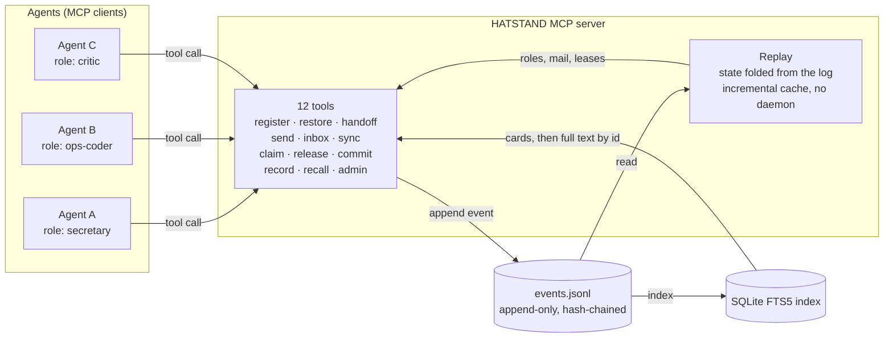
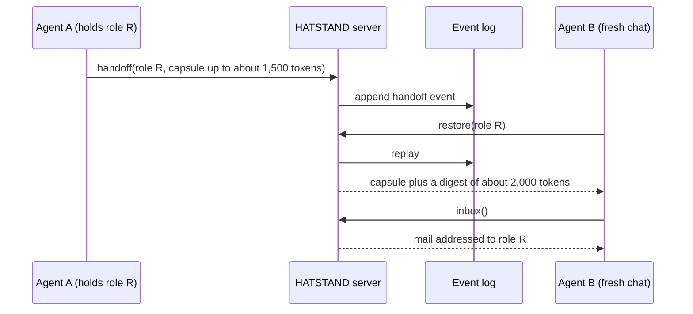
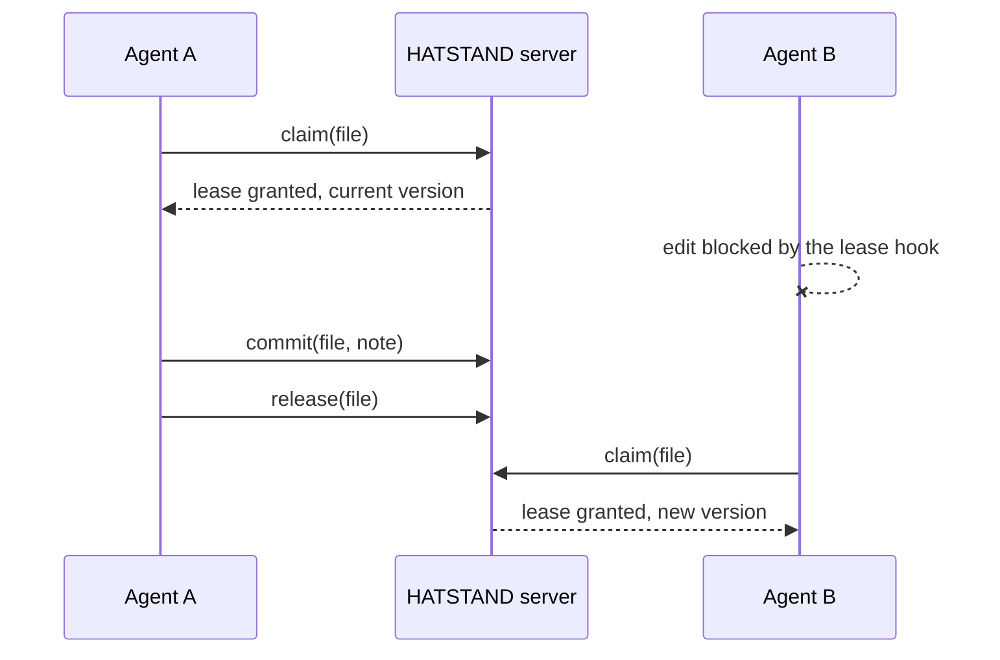
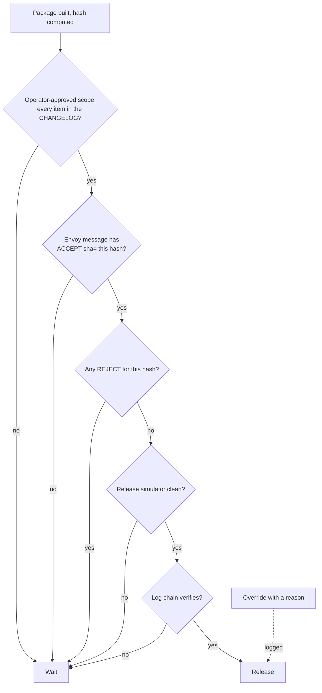

# HATSTAND

A multi-agent harness for long-lived Claude work: a hash-chained event ledger, a decision corpus, durable roles, an MCP server, and the plugins that carry the protocol.

- `plugins/crew-coordinator`: the harness core (`scripts/harness.py`, `scripts/mcp_server.py`, `scripts/corpus.py`, hooks, skills, tests).
- `plugins/delegation-desk`, `excellent-etiquette`, `pixel-pilot`, `plugin-publications`: role, delegation, operator-preference, design and release skills.
- `.claude-plugin/marketplace.json`: the local marketplace manifest.
- `docs/harness-technical-overview.md`: what problem this solves, how it works, and what is novel.

## Why HATSTAND

Long coding sessions outgrow a chat. HATSTAND keeps what matters outside it:

- **Work survives compaction, restarts and new chats.** Decisions and state live in an append-only, hash-chained event log and a decision corpus, not in a chat's memory.
- **Roles hand off with their state.** A role passes on in a handoff capsule; a fresh chat restores it with its state and its waiting mail, so a multi-hour or overnight build carries on across sessions.
- **Mail finds the current holder.** Mail goes to a role, and the server delivers it to whoever holds the role now. Where it can, it also asks the sender (or a relay) to ping an idle chat or run its wake routine; otherwise the mail waits for the chat's next turn.
- **Releases pass gates.** Publishing needs an ACCEPT from the envoy role naming the package hash, an operator-approved scope that the changelog covers, and a clean run of a release simulator; the crew also runs the full test suite and a ledger replay check before asking for the ACCEPT, as process rather than as code.
- **One writer per file.** Leases mark one writer per file, and a hook blocks an edit of a file another agent holds.

In practice: a release of HATSTAND's own server went through five fix rounds over many hours and a change of builder chat, and carried on from the log and the handoff without losing state.

## How it works

HATSTAND is an MCP server that lets several LLM agents work as a crew on one machine. The name is an acronym: HATSTAND = Handoffs, Archive, Tasks, Stewardship, Trust, Anchors, Notes, Decisions. You give each agent a role. The agents coordinate through the server's tools and never message each other directly.



### One log

HATSTAND keeps a single append-only, hash-chained event log. Each tool call appends an event. The server folds state from the log, caches it incrementally, and rebuilds from the log whenever the cache does not match, so you run no daemon. Run `harness.py verify` to check the chain; it exits with an error on a mismatch.

### Twelve tools

| Tool | What an agent does with it |
|---|---|
| `register`, `restore`, `handoff` | Join the crew, take over a role, pass a role on |
| `send`, `inbox`, `sync` | Mail a role or an agent, read mail, see what changed |
| `claim`, `release`, `commit` | Lease a file before editing it, give it back, record the new version |
| `record`, `recall` | Write a decision or note to the shared corpus, search it |
| `admin` | Roster, role definitions, approvals, health checks |

### Roles outlive agents

You address mail to a role. The server resolves the role to its current holder when the mail is read. When a chat fills its context window, the agent writes a handoff capsule of at most about 1,500 tokens, and a fresh agent restores the role from that capsule plus a digest of about 2,000 tokens.



A role can carry its history forward or start clean.

### Shared records and recall

The server indexes events into SQLite full-text search. `recall` returns one-line cards, then full text by id inside a token budget you set. Records have a kind (decision, note, context, capsule), tags, and links to the records they supersede.

### One writer per file

A lease marks one writer per file. Leases are advisory: a hook denies an edit on a file another agent holds. The hook fails open by design, so a hook error never blocks a session. An optional strict mode (`HARNESS_STRICT=1`) also requires a claim before any edit.



### Release gates

A release goes out only after all of these hold:

1. The operator approved the release scope, and the package's CHANGELOG section names every scope item.
2. The envoy role sent a message with an `ACCEPT sha=<hash prefix>` line naming the package hash, and no `REJECT` for that hash follows it.
3. The release simulator runs clean against the candidate tree.
4. The log chain verifies.
5. The seven-day release cadence is met, or a hotfix flag or an operator override waives it.

An override needs a stated reason, and the log records it.



## The bet

Most agent tooling moves toward larger context windows and memory shared across every chat. HATSTAND goes the other way. Agents are short-lived on purpose, each role keeps its own memory, and continuity comes from structured handoff.

## Research in progress

HATSTAND is also the test bed for a study of one question: with short-lived agents and memory split by role, how do you show that the system learned from a failure? The working thesis is that an agent has learned when a failure it once made can no longer recur, shown on a held-out test above a measured noise floor.

The study ranks four kinds of evidence, strongest first:

1. The failure is prevented by construction.
2. A held-out test improves by more than the noise floor.
3. Removing the lesson brings the failure back.
4. The agent restates the rule and its reason before acting.

The study has published no findings yet.

## Quick start (macOS or Linux)

```bash
git clone https://github.com/Braindono/hatstand.git && cd hatstand
./setup.sh --link --test      # creates the shared folder, config, ~/.local/bin/harness; runs the tests
```

`setup.sh` checks for Python 3.8+ and SQLite FTS5, creates the shared folder (default `<workspace>/Projects/Exchange`, or `--home PATH`), writes the default config there, and prints the remaining steps: add this repo as a Claude Code marketplace (`/plugin marketplace add <repo path>`), install the plugins from `harness-local`, and set `HARNESS_HOME`. It never overwrites existing config or data, and can be re-run. `bin/harness` is the CLI launcher (`harness roster`, `harness serve`, `harness pending`, `harness approve <id>`); `bin/wake.py` is the pass-the-ball wake registry. `config.example.json` shows the settings you can override.

The crew-coordinator test suite (3,109 tests) passes on a clean checkout.

Not included: the live ledger (`events.jsonl`), the decision corpus, registry and operator config. These are runtime data, not source. Pure Python 3.8+ standard library; no dependencies.

## License

Licensed under the Apache License 2.0; see LICENSE. `plugins/excellent-etiquette` also contains third-party code under the MIT License; see `plugins/excellent-etiquette/LICENSE`.

## Commands

<!-- commands:begin (generated from the skills' descriptions; do not edit) -->

| Plugin | Command | What it does | When to use it |
|---|---|---|---|
| crew-coordinator | `/compress [project]` | shrink a corpus safely, archive never delete | run /compress [project] |
| crew-coordinator | `/health` | Read-only corpus report (token weight, stale, orphans) | "/health", "corpus health" |
| crew-coordinator | `/idle-wake on\|off\|status` | opt-in 55-minute idle handoff | run /idle-wake on\|off\|status |
| crew-coordinator | `/listen` | - | /listen wake text arrives or an enabled role with an open task self-wakes. Opt-in |
| crew-coordinator | `/prune [project]` | Review corpus health flags, pin/archive, verify | "/prune [project]", "prune corpus" |
| crew-coordinator | `/refresh` | Light sync, inbox and Do-lines only | "/refresh", "check mail", routine checks |
| crew-coordinator | `/restore [role]` | Take over a role in a fresh chat without a handoff | "/restore [role]", "restore as" |
| crew-coordinator | `/save` | pre-compaction save, no handoff | "/save", "before compaction", "save state" |
| crew-coordinator | `/update` | Full sync after big change or resume | "/update", "what changed" |
| excellent-etiquette | `/argue [topic]` | the operator wants a committee debate of options before deciding | run /argue [topic] |
| excellent-etiquette | `/song [topic\|this] [poet]` | the operator wants the facts of a topic or conversation as a prose poem | run /song [topic\|this] [poet] |
| excellent-etiquette | `/swarm [task]` | a task has 3+ independent parts to fan out to ephemeral subagents or role peers | run /swarm [task] |
| pixel-pilot | `/design` | Design work: critique, design system, dev handoff, UX copy, accessibility (WCAG AA), research plans and synthesis | /design or any of these |
| plugin-publications | `/list` | custom plugins A-Z from the release registry - status, version, /commands | "list", "list plugins", "plugin status", "loaded" |
| plugin-publications | `/new-skill` | - | creating, rewriting or packaging any skill or plugin, /new-skill, new skill, new plugin |
| plugin-publications | `/upgrade [--dry-run]` | install published Harness plugin updates, then reload and verify | upgrade, install updates, plugins behind |

<!-- commands:end -->

## Limits

- The local dashboard has no authentication. It listens on loopback only, and it checks a CSRF token and the Host header on writes.
- Locks are advisory. Two agents that check and then append at the same moment can fork the chain. `verify` detects a fork; it cannot prevent one.
- Mail is never lost, but some wake-ups can be missed, so a reply may come late; see `plugins/crew-coordinator/docs/delivery-invariants.md` section 5.

These limits are planned for the next redesign.
